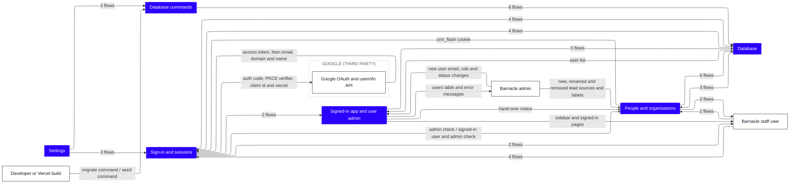
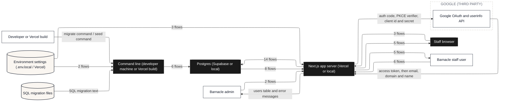
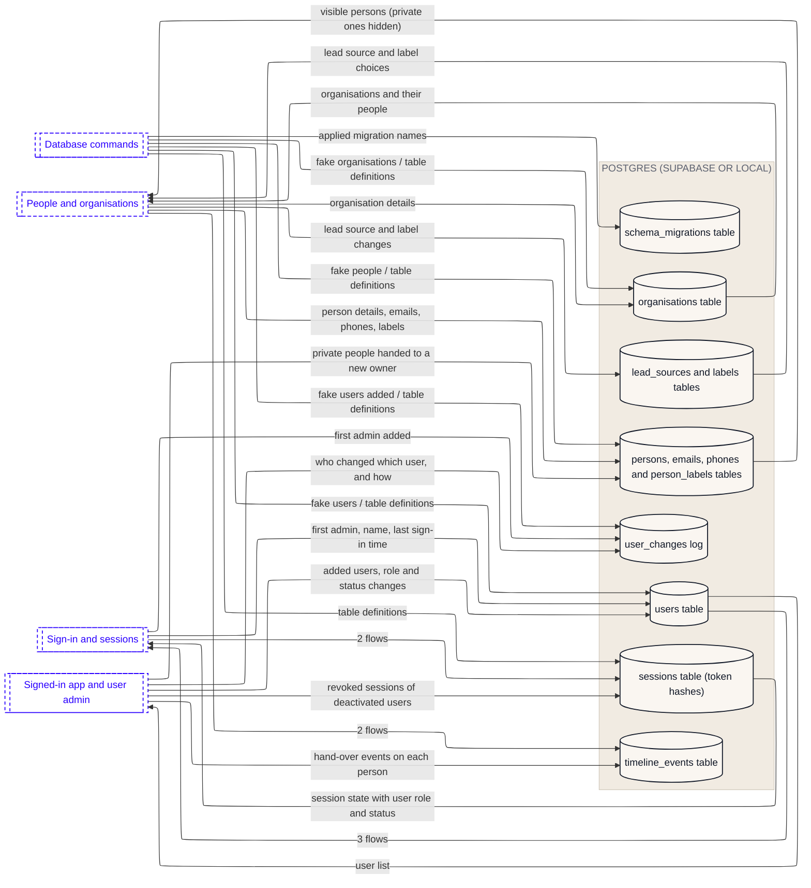
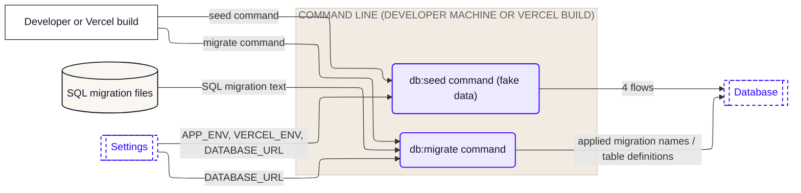
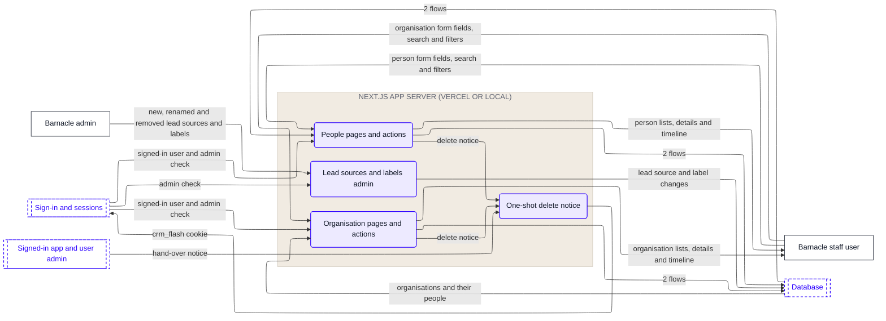
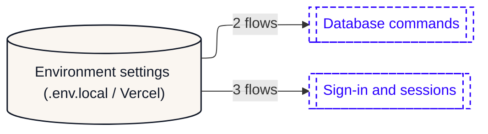
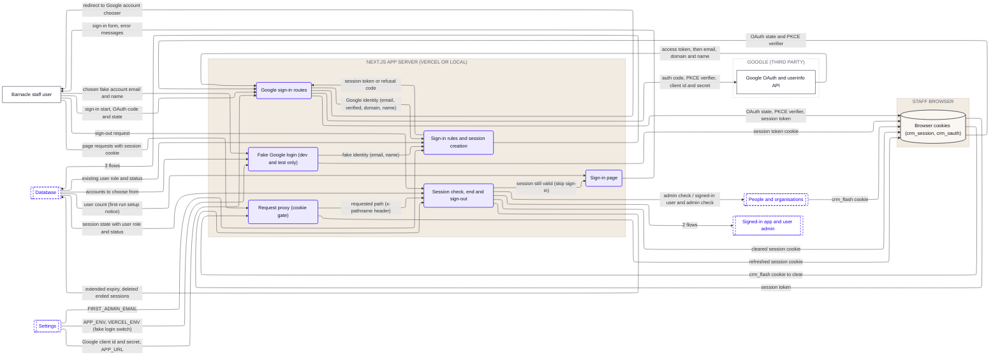
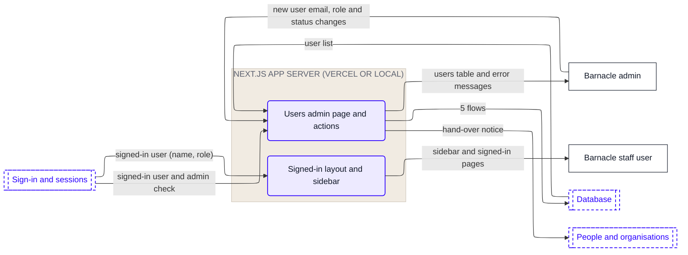

# Data flow

How data moves through this repo: who and what it exchanges data with, where it keeps it, and which trust zone each part runs in. Generated by the software factory from [`model.json`](model.json) in every pull request: do not edit this file, it is rewritten. The dashboard's Data flow page shows the same views.

White boxes are outside actors, blue rounded boxes processes, cylinders data stores, a frame a trust zone. A dark box is a whole trust zone, a blue box a whole subsystem (dashed: a neighbouring one).

## Subsystems

Processes and stores grouped by the job they do, with the outside actors they talk to.

| Subsystem | What it does | Parts |
|---|---|---|
| Database | The Postgres tables every part reads and writes: users, sessions, the user change log and applied migrations. | lead_sources and labels tables, organisations table, persons, emails, phones and person_labels tables, schema_migrations table, sessions table (token hashes), timeline_events table, user_changes log, users table |
| Database commands | Command-line tools that apply SQL migrations and load fake data into Postgres. | db:migrate command, SQL migration files, db:seed command (fake data) |
| People and organisations | Staff list, search, create, edit, archive and delete people and organisations, with a timeline and shared lead sources and labels. | Lead sources and labels admin, Organisation pages and actions, People pages and actions, One-shot delete notice |
| Settings | Environment variables (.env.local or Vercel settings) that hold secrets and switch features on or off. | Environment settings (.env.local / Vercel) |
| Sign-in and sessions | Signs barnacle.ai staff in with Google (or the fake login), keeps their session cookie and checks it on every page. | Browser cookies (crm_session, crm_oauth), Sign-in rules and session creation, Fake Google login (dev and test only), Google sign-in routes, Request proxy (cookie gate), Session check, end and sign-out, Sign-in page |
| Signed-in app and user admin | Draws the signed-in pages and lets admins add users, change roles and deactivate accounts. | Signed-in layout and sidebar, Users admin page and actions |

## Trust boundaries

Each zone that runs the repo's code is one dark box; outside services stay separate. An arrow is every flow that crosses from one box to another.

## Each subsystem

### Database

The Postgres tables every part reads and writes: users, sessions, the user change log and applied migrations.

### Database commands

Command-line tools that apply SQL migrations and load fake data into Postgres.

### People and organisations

Staff list, search, create, edit, archive and delete people and organisations, with a timeline and shared lead sources and labels.

### Settings

Environment variables (.env.local or Vercel settings) that hold secrets and switch features on or off.

### Sign-in and sessions

Signs barnacle.ai staff in with Google (or the fake login), keeps their session cookie and checks it on every page.

### Signed-in app and user admin

Draws the signed-in pages and lets admins add users, change roles and deactivate accounts.

## Parts

| Part | Kind | Subsystem | Zone | Sources |
|---|---|---|---|---|
| Barnacle admin | actor |  |  |  |
| Signed-in layout and sidebar | process | Signed-in app and user admin | Next.js app server (Vercel or local) | `src/app/(app)/layout.tsx`, `src/app/(app)/nav.ts` |
| Browser cookies (crm_session, crm_oauth) | store | Sign-in and sessions | Staff browser | `src/server/auth/cookie.ts` |
| Lead sources and labels admin | process | People and organisations | Next.js app server (Vercel or local) | `src/app/(app)/admin/lead-sources-and-labels`, `src/server/records/choices.ts` |
| lead_sources and labels tables | store | Database | Postgres (Supabase or local) | `migrations/0002_people_organisations.sql` |
| Sign-in rules and session creation | process | Sign-in and sessions | Next.js app server (Vercel or local) | `src/server/auth/rules.ts`, `src/server/auth/sign-in.ts` |
| Developer or Vercel build | actor |  |  |  |
| Environment settings (.env.local / Vercel) | store | Settings |  | `.env.example`, `src/server/env.ts` |
| Fake Google login (dev and test only) | process | Sign-in and sessions | Next.js app server (Vercel or local) | `src/app/dev/fake-google` |
| Google sign-in routes | process | Sign-in and sessions | Next.js app server (Vercel or local) | `src/app/auth/google`, `src/server/auth/google.ts` |
| Google OAuth and userinfo API | actor |  | Google (third party) |  |
| db:migrate command | process | Database commands | Command line (developer machine or Vercel build) | `scripts/migrate.ts` |
| SQL migration files | store | Database commands |  | `migrations` |
| Organisation pages and actions | process | People and organisations | Next.js app server (Vercel or local) | `src/app/(app)/organisations`, `src/server/records/organisations.ts` |
| organisations table | store | Database | Postgres (Supabase or local) | `migrations/0002_people_organisations.sql` |
| People pages and actions | process | People and organisations | Next.js app server (Vercel or local) | `src/app/(app)/people`, `src/server/records/people.ts`, `src/server/records/visibility.ts` |
| persons, emails, phones and person_labels tables | store | Database | Postgres (Supabase or local) | `migrations/0002_people_organisations.sql` |
| Request proxy (cookie gate) | process | Sign-in and sessions | Next.js app server (Vercel or local) | `src/proxy.ts` |
| One-shot delete notice | process | People and organisations | Next.js app server (Vercel or local) | `src/server/records/flash-cookie.ts`, `src/server/records/flash.ts` |
| schema_migrations table | store | Database | Postgres (Supabase or local) | `scripts/migrate.ts` |
| db:seed command (fake data) | process | Database commands | Command line (developer machine or Vercel build) | `scripts/seed.ts`, `src/seed` |
| Session check, end and sign-out | process | Sign-in and sessions | Next.js app server (Vercel or local) | `src/app/(app)/actions.ts`, `src/app/auth/end/route.ts`, `src/server/auth/session.ts` |
| sessions table (token hashes) | store | Database | Postgres (Supabase or local) | `migrations/0001_users_sessions.sql` |
| Sign-in page | process | Sign-in and sessions | Next.js app server (Vercel or local) | `src/app/sign-in/page.tsx`, `src/server/sign-in-page.ts` |
| Barnacle staff user | actor |  |  |  |
| timeline_events table | store | Database | Postgres (Supabase or local) | `migrations/0002_people_organisations.sql` |
| user_changes log | store | Database | Postgres (Supabase or local) | `migrations/0001_users_sessions.sql` |
| Users admin page and actions | process | Signed-in app and user admin | Next.js app server (Vercel or local) | `src/app/(app)/admin/users`, `src/server/users.ts` |
| users table | store | Database | Postgres (Supabase or local) | `migrations/0001_users_sessions.sql` |

## Flows

| From | To | Data | Sources |
|---|---|---|---|
| Barnacle admin | Lead sources and labels admin | new, renamed and removed lead sources and labels | `src/app/(app)/admin/lead-sources-and-labels/actions.ts` |
| Barnacle admin | Users admin page and actions | new user email, role and status changes | `src/app/(app)/admin/users` |
| Signed-in layout and sidebar | Barnacle staff user | sidebar and signed-in pages | `src/app/(app)/layout.tsx` |
| Browser cookies (crm_session, crm_oauth) | Google sign-in routes | OAuth state and PKCE verifier | `src/app/auth/google/callback/route.ts` |
| Browser cookies (crm_session, crm_oauth) | Request proxy (cookie gate) | crm_flash cookie to clear | `src/proxy.ts` |
| Browser cookies (crm_session, crm_oauth) | Session check, end and sign-out | session token | `src/app/auth/end/route.ts`, `src/server/auth/session.ts` |
| Lead sources and labels admin | lead_sources and labels tables | lead source and label changes | `src/server/records/choices.ts` |
| lead_sources and labels tables | People pages and actions | lead source and label choices | `src/server/records/choices.ts` |
| Sign-in rules and session creation | Google sign-in routes | session token or refusal code | `src/app/auth/google/callback/route.ts`, `src/server/auth/sign-in.ts` |
| Sign-in rules and session creation | sessions table (token hashes) | new session token hash, expiry | `src/server/auth/session.ts`, `src/server/auth/sign-in.ts` |
| Sign-in rules and session creation | user_changes log | first admin added | `src/server/auth/sign-in.ts` |
| Sign-in rules and session creation | users table | first admin, name, last sign-in time | `src/server/auth/sign-in.ts` |
| Developer or Vercel build | db:migrate command | migrate command | `package.json`, `scripts/migrate.ts` |
| Developer or Vercel build | db:seed command (fake data) | seed command | `package.json`, `scripts/seed.ts` |
| Environment settings (.env.local / Vercel) | Sign-in rules and session creation | FIRST_ADMIN_EMAIL | `src/server/auth/sign-in.ts`, `src/server/env.ts` |
| Environment settings (.env.local / Vercel) | Fake Google login (dev and test only) | APP_ENV, VERCEL_ENV (fake login switch) | `src/app/dev/fake-google/actions.ts`, `src/server/env.ts` |
| Environment settings (.env.local / Vercel) | Google sign-in routes | Google client id and secret, APP_URL | `src/server/auth/google.ts`, `src/server/env.ts` |
| Environment settings (.env.local / Vercel) | db:migrate command | DATABASE_URL | `scripts/migrate.ts`, `src/server/db.ts` |
| Environment settings (.env.local / Vercel) | db:seed command (fake data) | APP_ENV, VERCEL_ENV, DATABASE_URL | `scripts/seed.ts`, `src/server/db.ts` |
| Fake Google login (dev and test only) | Browser cookies (crm_session, crm_oauth) | session token cookie | `src/app/dev/fake-google/actions.ts`, `src/server/auth/session.ts` |
| Fake Google login (dev and test only) | Sign-in rules and session creation | fake identity (email, name) | `src/app/dev/fake-google/actions.ts` |
| Google sign-in routes | Browser cookies (crm_session, crm_oauth) | OAuth state, PKCE verifier, session token | `src/app/auth/google/callback/route.ts`, `src/app/auth/google/start/route.ts` |
| Google sign-in routes | Sign-in rules and session creation | Google identity (email, verified, domain, name) | `src/app/auth/google/callback/route.ts` |
| Google sign-in routes | Google OAuth and userinfo API | auth code, PKCE verifier, client id and secret | `src/server/auth/google.ts` |
| Google sign-in routes | Barnacle staff user | redirect to Google account chooser | `src/app/auth/google/start/route.ts`, `src/server/auth/google.ts` |
| Google OAuth and userinfo API | Google sign-in routes | access token, then email, domain and name | `src/server/auth/google.ts` |
| db:migrate command | organisations table | table definitions | `migrations/0002_people_organisations.sql`, `scripts/migrate.ts` |
| db:migrate command | persons, emails, phones and person_labels tables | table definitions | `migrations/0002_people_organisations.sql`, `scripts/migrate.ts` |
| db:migrate command | schema_migrations table | applied migration names | `scripts/migrate.ts` |
| db:migrate command | sessions table (token hashes) | table definitions | `migrations/0001_users_sessions.sql`, `scripts/migrate.ts` |
| db:migrate command | user_changes log | table definitions | `migrations/0001_users_sessions.sql`, `scripts/migrate.ts` |
| db:migrate command | users table | table definitions | `migrations/0001_users_sessions.sql`, `scripts/migrate.ts` |
| SQL migration files | db:migrate command | SQL migration text | `scripts/migrate.ts` |
| Organisation pages and actions | organisations table | organisation details | `src/server/records/organisations.ts` |
| Organisation pages and actions | One-shot delete notice | delete notice | `src/server/records/flash.ts` |
| Organisation pages and actions | Barnacle staff user | organisation lists, details and timeline | `src/app/(app)/organisations/page.tsx` |
| Organisation pages and actions | timeline_events table | organisation timeline events | `src/server/records/timeline.ts` |
| organisations table | Organisation pages and actions | organisations and their people | `src/server/records/organisations.ts` |
| People pages and actions | persons, emails, phones and person_labels tables | person details, emails, phones, labels | `src/server/records/people.ts` |
| People pages and actions | One-shot delete notice | delete notice | `src/app/(app)/people/actions.ts`, `src/server/records/flash.ts` |
| People pages and actions | Barnacle staff user | person lists, details and timeline | `src/app/(app)/people/page.tsx` |
| People pages and actions | timeline_events table | person timeline events | `src/server/records/timeline.ts` |
| persons, emails, phones and person_labels tables | People pages and actions | visible persons (private ones hidden) | `src/server/records/people.ts`, `src/server/records/visibility.ts` |
| Request proxy (cookie gate) | Browser cookies (crm_session, crm_oauth) | refreshed session cookie | `src/proxy.ts` |
| Request proxy (cookie gate) | Session check, end and sign-out | requested path (x-pathname header) | `src/proxy.ts`, `src/server/auth/session.ts` |
| One-shot delete notice | Browser cookies (crm_session, crm_oauth) | crm_flash cookie | `src/server/records/flash.ts` |
| db:seed command (fake data) | organisations table | fake organisations | `src/seed/people.ts` |
| db:seed command (fake data) | persons, emails, phones and person_labels tables | fake people | `src/seed/people.ts` |
| db:seed command (fake data) | user_changes log | fake users added | `src/seed/users.ts` |
| db:seed command (fake data) | users table | fake users | `src/seed/users.ts` |
| Session check, end and sign-out | Signed-in layout and sidebar | signed-in user (name, role) | `src/app/(app)/layout.tsx`, `src/server/auth/session.ts` |
| Session check, end and sign-out | Browser cookies (crm_session, crm_oauth) | cleared session cookie | `src/app/(app)/actions.ts`, `src/app/auth/end/route.ts` |
| Session check, end and sign-out | Lead sources and labels admin | admin check | `src/app/(app)/admin/lead-sources-and-labels/actions.ts` |
| Session check, end and sign-out | Organisation pages and actions | signed-in user and admin check | `src/app/(app)/organisations/actions.ts`, `src/server/auth/session.ts` |
| Session check, end and sign-out | People pages and actions | signed-in user and admin check | `src/app/(app)/people/actions.ts`, `src/server/auth/session.ts` |
| Session check, end and sign-out | sessions table (token hashes) | extended expiry, deleted ended sessions | `src/server/auth/session.ts` |
| Session check, end and sign-out | Sign-in page | session still valid (skip sign-in) | `src/app/sign-in/page.tsx` |
| Session check, end and sign-out | Users admin page and actions | signed-in user and admin check | `src/app/(app)/admin/users`, `src/server/auth/session.ts` |
| sessions table (token hashes) | Session check, end and sign-out | session state with user role and status | `src/server/auth/session.ts` |
| Sign-in page | Barnacle staff user | sign-in form, error messages | `src/app/sign-in/page.tsx` |
| Barnacle staff user | Fake Google login (dev and test only) | chosen fake account email and name | `src/app/dev/fake-google/actions.ts` |
| Barnacle staff user | Google sign-in routes | sign-in start, OAuth code and state | `src/app/auth/google/callback/route.ts`, `src/app/auth/google/start/route.ts` |
| Barnacle staff user | Organisation pages and actions | organisation form fields, search and filters | `src/app/(app)/organisations/actions.ts`, `src/server/records/list-query.ts` |
| Barnacle staff user | People pages and actions | person form fields, search and filters | `src/app/(app)/people/actions.ts`, `src/server/records/list-query.ts` |
| Barnacle staff user | Request proxy (cookie gate) | page requests with session cookie | `src/proxy.ts` |
| Barnacle staff user | Session check, end and sign-out | sign-out request | `src/app/(app)/actions.ts` |
| Users admin page and actions | Barnacle admin | users table and error messages | `src/app/(app)/admin/users/page.tsx` |
| Users admin page and actions | persons, emails, phones and person_labels tables | private people handed to a new owner | `src/app/(app)/admin/users/actions.ts`, `src/server/records/handover.ts` |
| Users admin page and actions | One-shot delete notice | hand-over notice | `src/app/(app)/admin/users/actions.ts`, `src/server/records/flash.ts` |
| Users admin page and actions | sessions table (token hashes) | revoked sessions of deactivated users | `src/server/auth/session.ts`, `src/server/users.ts` |
| Users admin page and actions | timeline_events table | hand-over events on each person | `src/server/records/handover.ts`, `src/server/records/timeline.ts` |
| Users admin page and actions | user_changes log | who changed which user, and how | `src/server/users.ts` |
| Users admin page and actions | users table | added users, role and status changes | `src/server/users.ts` |
| users table | Sign-in rules and session creation | existing user role and status | `src/server/auth/sign-in.ts` |
| users table | Fake Google login (dev and test only) | accounts to choose from | `src/app/dev/fake-google/page.tsx` |
| users table | Sign-in page | user count (first-run setup notice) | `src/server/sign-in-page.ts` |
| users table | Users admin page and actions | user list | `src/server/users.ts` |
